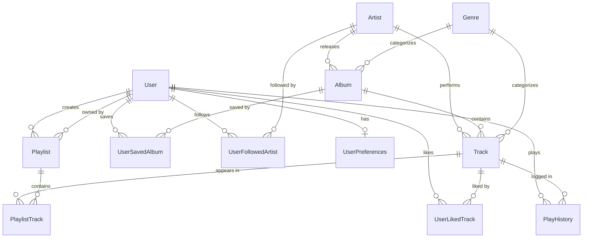

# Spotify Web Reconstruction - Data Model & Schema Specification

This document defines the relational database architecture and Prisma schema powering the Spotify Web reconstruction.

---

## 1. Entity Relationship Diagram (ERD)



---

## 2. Prisma Schema Definition

```prisma
datasource db {
  provider = "sqlite" // Can be switched to postgresql seamlessly
  url      = env("DATABASE_URL")
}

generator client {
  provider = "prisma-client-js"
}

model User {
  id           String    @id @default(uuid())
  email        String    @unique
  passwordHash String
  displayName  String
  avatarUrl    String?
  role         String    @default("USER") // USER, ADMIN
  plan         String    @default("FREE") // FREE, PREMIUM, FAMILY
  createdAt    DateTime  @default(now())
  updatedAt    DateTime  @updatedAt

  playlists       Playlist[]
  likedTracks     UserLikedTrack[]
  savedAlbums     UserSavedAlbum[]
  followedArtists UserFollowedArtist[]
  playHistory     PlayHistory[]
  preferences     UserPreferences?

  @@index([email])
}

model UserPreferences {
  id                    String   @id @default(uuid())
  userId                String   @unique
  user                  User     @relation(fields: [userId], references: [id], onDelete: Cascade)
  autoplay              Boolean  @default(true)
  crossfadeSeconds      Int      @default(0)
  normalizeVolume       Boolean  @default(true)
  audioQuality          String   @default("HIGH") // LOW, NORMAL, HIGH, VERY_HIGH
  explicitContentFilter Boolean  @default(false)
  language              String   @default("en")
  updatedAt             DateTime @updatedAt
}

model Artist {
  id               String   @id @default(uuid())
  name             String
  bio              String?
  avatarUrl        String
  headerUrl        String?
  verified         Boolean  @default(true)
  monthlyListeners Int      @default(0)
  rankGlobal       Int?
  createdAt        DateTime @default(now())

  albums    Album[]
  tracks    Track[]
  followers UserFollowedArtist[]

  @@index([name])
}

model Album {
  id          String   @id @default(uuid())
  title       String
  coverUrl    String
  releaseYear Int
  releaseDate String?
  type        String   @default("album") // album, single, ep, compilation
  copyright   String?
  artistId    String
  artist      Artist   @relation(fields: [artistId], references: [id], onDelete: Cascade)
  genreId     String?
  genre       Genre?   @relation(fields: [genreId], references: [id])
  createdAt   DateTime @default(now())

  tracks Track[]
  saves  UserSavedAlbum[]

  @@index([artistId])
  @@index([title])
}

model Track {
  id          String   @id @default(uuid())
  title       String
  duration    Int      // Duration in seconds
  streamCount BigInt   @default(0)
  audioUrl    String   // Direct URL to audio file (MP3 / AAC stream)
  lyrics      String?  // LRC formatted or raw plain text with timestamps
  explicit    Boolean  @default(false)
  trackNumber Int      @default(1)
  discNumber  Int      @default(1)
  albumId     String
  album       Album    @relation(fields: [albumId], references: [id], onDelete: Cascade)
  artistId    String
  artist      Artist   @relation(fields: [artistId], references: [id], onDelete: Cascade)
  genreId     String?
  genre       Genre?   @relation(fields: [genreId], references: [id])
  createdAt   DateTime @default(now())

  playlistTracks PlaylistTrack[]
  likedBy        UserLikedTrack[]
  playHistory    PlayHistory[]

  @@index([albumId])
  @@index([artistId])
  @@index([title])
}

model Genre {
  id       String  @id @default(uuid())
  name     String  @unique
  slug     String  @unique
  colorHex String  // Background color token for browse tile
  imageUrl String?

  albums Album[]
  tracks Track[]
}

model Playlist {
  id          String   @id @default(uuid())
  title       String
  description String?
  coverUrl    String?
  isPublic    Boolean  @default(true)
  ownerId     String
  owner       User     @relation(fields: [ownerId], references: [id], onDelete: Cascade)
  createdAt   DateTime @default(now())
  updatedAt   DateTime @updatedAt

  tracks PlaylistTrack[]

  @@index([ownerId])
  @@index([title])
}

model PlaylistTrack {
  id         String   @id @default(uuid())
  playlistId String
  playlist   Playlist @relation(fields: [playlistId], references: [id], onDelete: Cascade)
  trackId    String
  track      Track    @relation(fields: [trackId], references: [id], onDelete: Cascade)
  position   Int      @default(0)
  addedAt    DateTime @default(now())
  addedById  String?

  @@unique([playlistId, trackId])
  @@index([playlistId, position])
}

model UserLikedTrack {
  id      String   @id @default(uuid())
  userId  String
  user    User     @relation(fields: [userId], references: [id], onDelete: Cascade)
  trackId String
  track   Track    @relation(fields: [trackId], references: [id], onDelete: Cascade)
  likedAt DateTime @default(now())

  @@unique([userId, trackId])
  @@index([userId])
}

model UserSavedAlbum {
  id      String   @id @default(uuid())
  userId  String
  user    User     @relation(fields: [userId], references: [id], onDelete: Cascade)
  albumId String
  album   Album    @relation(fields: [albumId], references: [id], onDelete: Cascade)
  savedAt DateTime @default(now())

  @@unique([userId, albumId])
  @@index([userId])
}

model UserFollowedArtist {
  id         String   @id @default(uuid())
  userId     String
  user       User     @relation(fields: [userId], references: [id], onDelete: Cascade)
  artistId   String
  artist     Artist   @relation(fields: [artistId], references: [id], onDelete: Cascade)
  followedAt DateTime @default(now())

  @@unique([userId, artistId])
  @@index([userId])
}

model PlayHistory {
  id       String   @id @default(uuid())
  userId   String
  user     User     @relation(fields: [userId], references: [id], onDelete: Cascade)
  trackId  String
  track    Track    @relation(fields: [trackId], references: [id], onDelete: Cascade)
  playedAt DateTime @default(now())

  @@index([userId, playedAt])
}
```
