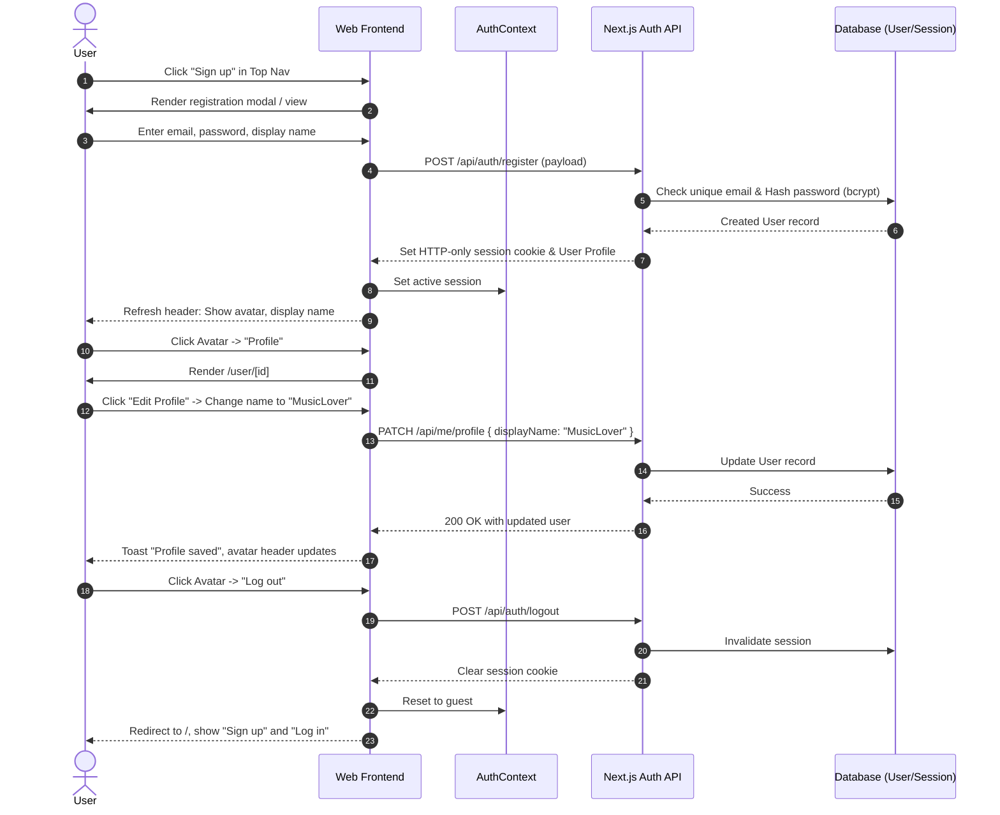
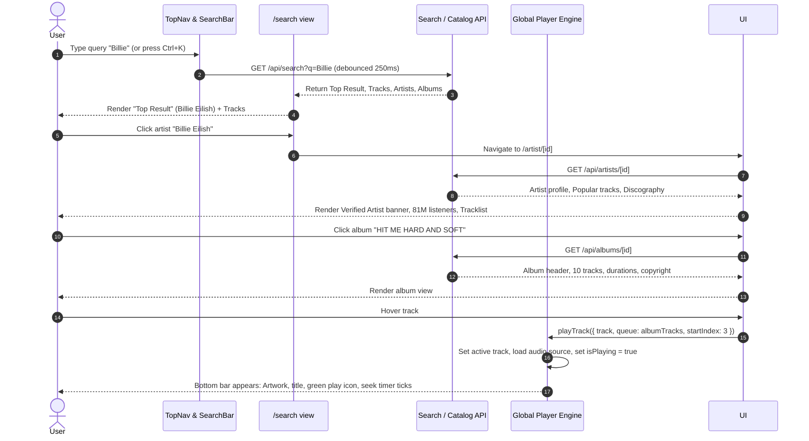
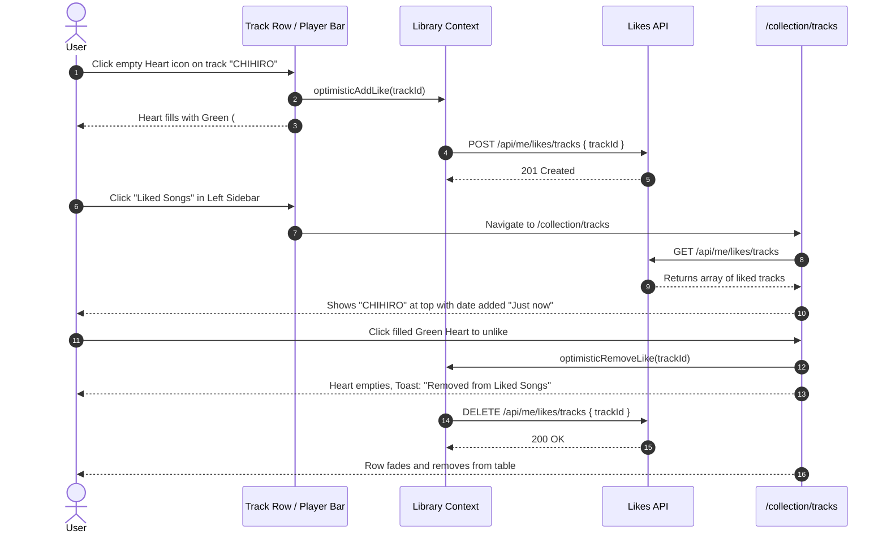
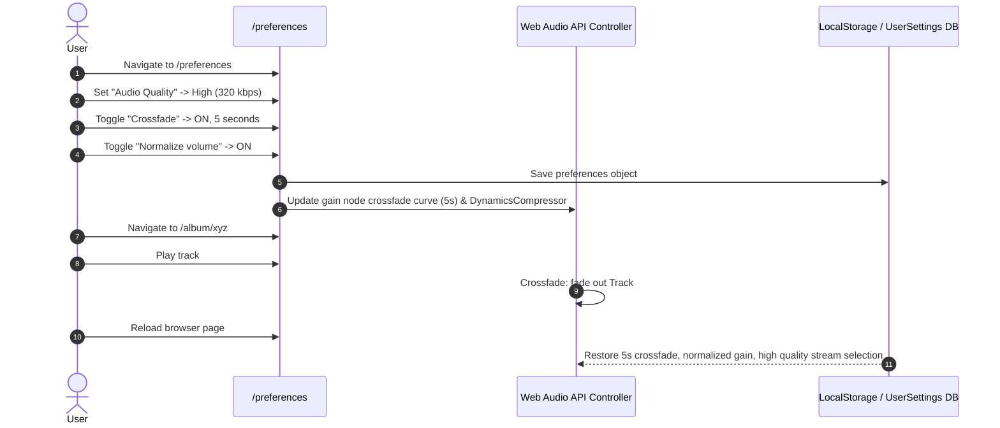

# Spotify Web Reconstruction - User Flows & Interaction Architecture

This document formalizes the complete user interaction flows across Spotify Web. Each flow specifies pre-conditions, user gestures, system state changes, UI transitions, and persistence checks.

---

## Journey 1: Authentication & Account Lifecycle



---

## Journey 2: Search, Discovery & Playback Activation



---

## Journey 3: Playlist Creation, Management & Track Reordering

```mermaid
flowchart TD
    Start([User in Library]) --> ClickCreate[Click '+' or press 'Ctrl+N']
    ClickCreate --> APICreate[POST /api/playlists: 'My Playlist #1']
    APICreate --> NavPlaylist[Redirect to /playlist/id]
    
    NavPlaylist --> OpenEdit[Click playlist title or cover]
    OpenEdit --> ShowModal[Render Edit Details Modal]
    ShowModal --> FillForm[Change Title: 'Summer Chill 2026', add description]
    FillForm --> SaveEdit[Click Save -> PATCH /api/playlists/id]
    SaveEdit --> UpdateHeader[Header updates optimistically]

    UpdateHeader --> BrowseMusic[Browse or Search for tracks]
    BrowseMusic --> RightClick[Right click track -> Add to Playlist]
    RightClick --> SelectPlaylist[Select 'Summer Chill 2026']
    SelectPlaylist --> APIAdd[POST /api/playlists/id/tracks]
    APIAdd --> ShowToast[Toast: 'Added to Summer Chill 2026']

    ShowToast --> ReorderTracks[Drag track row from pos #3 to pos #1]
    ReorderTracks --> PutOrder[PUT /api/playlists/id/tracks/reorder]
    PutOrder --> VerifyDB[(Database stores new sequence)]
    VerifyDB --> ReloadPage[User reloads page F5]
    ReloadPage --> FetchPlaylist[GET /api/playlists/id]
    FetchPlaylist --> AssertOrder[Verify track #1 is the moved track]
```



---

## Journey 4: Like Track, Library Synchronization & Unlike



---

## Journey 5: Queue Management, Shuffle, Repeat & Audio Skipping

```mermaid
flowchart TD
    Playing[Track #1 Playing from Album] --> AddQueue[User right-clicks Track X -> 'Add to queue']
    AddQueue --> QueueAppend[PlayerContext.userQueue.push(Track X)]
    QueueAppend --> AddNext[User right-clicks Track Y -> 'Play next']
    AddNext --> QueuePrepend[PlayerContext.userQueue.splice(0, 0, Track Y)]
    
    QueuePrepend --> OpenQueue[User clicks Queue button in Bottom Bar]
    OpenQueue --> QueueView[Queue panel displays: Now Playing: #1, Next: Track Y, Track X, Next from Album: #2, #3]

    QueueView --> ClickNext[User clicks Next Track button or Ctrl+Right]
    ClickNext --> ConsumeQueue[PlayerContext pop next track from userQueue -> Track Y plays]
    ConsumeQueue --> RecheckQueue[Queue view updates: Track X is next]

    RecheckQueue --> ToggleShuffle[User toggles Shuffle button]
    ToggleShuffle --> ShuffledContext[Album context list shuffled randomly without touching user queue]
    
    ShuffledContext --> ToggleRepeat[User clicks Repeat: Off -> Repeat All -> Repeat One]
    ToggleRepeat --> TrackEnd[Track finishes playing]
    TrackEnd --> CheckRepeatMode{Repeat Mode?}
    CheckRepeatMode -- "Repeat One" --> ReplaySame[Seek to 0 and replay Track Y]
    CheckRepeatMode -- "Repeat All / Off" --> PlayNextTrack[Play Track X from user queue]
```

---

## Journey 6: Settings Persistence & Audio Processing



---

## Journey 7: Responsive Mobile & Tablet Layout Adaptations

```mermaid
flowchart LR
    Viewport{Viewport Width}
    
    Viewport -- ">= 1024px (Desktop)" --> DesktopLayout[Left Sidebar: 240-420px Resizable<br>Center: Scrollable Main View<br>Right: Optional Queue / Now Playing Panel<br>Bottom: Full 3-column Player Bar]
    
    Viewport -- "768px - 1023px (Tablet)" --> TabletLayout[Left Sidebar: Collapsed to 72px Icon Bar<br>Center: Full width main content<br>Right: Drawer overlay for Queue<br>Bottom: Player bar with condensed controls]
    
    Viewport -- "< 768px (Mobile)" --> MobileLayout[Sidebar hidden -> Bottom Navigation Bar (Home, Search, Your Library)<br>Center: 100vw content<br>Bottom: Compact Floating Mini-Player (64px) with Tap-to-expand Fullscreen Player]
```
